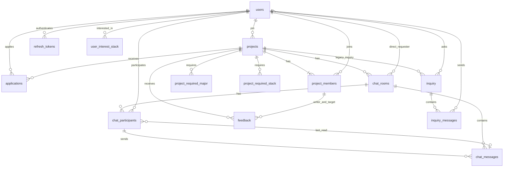

# F.A.T. Backend

프로젝트 모집·지원·팀 활동을 위한 Spring Boot / JPA / MySQL 백엔드.

## 설계 기준과 범위

기준 코드는 `1-feat-login-signup`의 `043c352bb93b02ea58602effd467aef76864a3c1`, PR 대상은 `dev`다. 기존 서비스·DTO에서 사용하는 Entity 이름, PK 값, 주요 컬럼 이름을 유지했다.

기능 기준은 제공된 노션 `F.A.T. API 명세서` 내보내기(페이지 `fc2a25fde89d442280b79de3e88a0fad`)의 API 목록이다. 원본 34개 중 GitHub OAuth 및 연동 4개를 제외한 30개 기능을 대상으로 데이터 모델을 설계했다. 첨부본에는 개별 API의 상세 요청·응답 필드, 학교 이메일 도메인, 토큰 만료 정책, 이미지 저장소, 추천 알고리즘이 없다. 이를 임의의 확정 명세로 취급하지 않는다.

이 변경은 스키마·Entity·Repository 및 기존 서비스의 데이터 일관성을 다룬다. 새로운 이메일 발송/JWT 인증, 파일 업로드, 검색·추천 API 전체 구현은 포함하지 않는다. 기존 `/signup`, `/login`, `/mypage`, `/projects/{id}/status` 경로를 모두 노션 경로로 전환하지도 않는다. 인증 메일·토큰 테이블이 존재한다고 해당 인증 API가 구현된 것은 아니다.

## 기존 구조 분석

| 기존 모델 | 관계와 문제 | 변경 |
| --- | --- | --- |
| `user` / User | 이메일 UNIQUE, 관심 스택 ElementCollection; DB 비밀번호 하드코딩 | `users`; 기존 계정·비밀번호 해시 보존, 환경변수 사용, 아바타 URL 추가 |
| `project` / Project | PM N:1 User, 전공·스택 컬렉션; 상태 변경 메서드가 빈 구현 | `projects`; 주요 필드 유지, 모집 여부 분리, 상태 변경 저장 |
| `project_application` | Project·신청자 N:1, 지원 상태; 중복 방지는 서비스 조회뿐 | `applications`; 프로젝트/지원자 UNIQUE, 포지션, 취소 이력 |
| 지원서 ACCEPTED | 수락된 지원서로만 팀원을 추정, PM 누락 | `project_members`; PM 및 수락자 명시적 등록 |
| `chat_room` | Project와 1:1 | `chat_rooms`; 프로젝트별 팀방 1개 + 신청자별 PM 커피챗 |
| `chat_message` | 방·발신자 FK만 있고 참여자 개념 없음 | `chat_messages`, `chat_participants`; 발신 참여와 읽음 위치 보장 |
| `feedback` | 프로젝트·작성자·대상 FK, 중복·평점 범위 제약 없음 | 기존 PK·데이터 유지; 중복·자기평가·평점·팀원 FK 제약 |
| `inquiry` / InquiryMessage | Inquiry 관계만 구현; InquiryMessage는 필드 선언이 없어 컴파일 불가 | Inquiry 보존, 독립 `inquiry_messages` 매핑 완성; 커피챗은 새 chat 모델 사용 |

기존 `UserRepository`의 JPQL `:email`과 메서드 인자명이 불일치해 명시적 `@Param`으로 수정했다. 프로젝트 생성/지원 수락/팀원 목록/채팅 접근도 새로운 연결 테이블을 사용한다. 마이페이지는 세션의 분리된 Entity를 직접 수정하는 대신 트랜잭션 안에서 재조회한다.

기존 설정에 포함됐던 DB 비밀번호는 제거했다. Git 이력에 남아 있으므로 해당 자격증명이 실제로 사용됐다면 소유자가 폐기·교체해야 한다. 이 변경은 이력을 강제 재작성하지 않는다.

## 테이블 관계



`email_verifications`는 가입 전 이메일을 다루므로 users FK가 없다. `project_members`의 PM/MEMBER 역할은 `projects.pm_id`와 비교해 도출한다. 중복 역할 컬럼을 두어 서로 어긋나게 만들지 않는다. PM이 팀원으로 등록되는 것은 서비스와 마이그레이션이 보장하며, FK만으로 모든 교차 테이블 규칙을 보장한다고 가정하지 않는다.

## 키와 제약조건

모든 식별자는 signed BIGINT AUTO_INCREMENT이며, 아래 연결 컬렉션만 복합 PK다. 기존 `*_id` 값은 변경하지 않는다. 모든 FK는 삭제 전파 없이 RESTRICT/NO ACTION을 사용한다. 사용자·프로젝트·팀원을 삭제해 메시지나 평가가 자동 소실되지 않는다.

| 테이블 | PK | FK / UNIQUE | NOT NULL 및 주요 규칙 |
| --- | --- | --- | --- |
| users | user_id | UNIQUE user_email | 비밀번호 해시·이메일·성별·전공·학번·이름 필수. bio/club/avatar/기존 github_username nullable |
| projects | project_id | pm_id → users | 제목·소개·마감일·단계·모집여부·정원·조회수 필수. 정원 > 0, 조회수 ≥ 0 |
| applications | application_id | project_id → projects, applicant_id → users; UNIQUE(project_id, applicant_id) | 상태 필수, 메시지/포지션은 레거시 보존을 위해 DB에서 nullable. 신규 요청은 둘 다 필수 |
| project_members | project_member_id | project_id → projects, user_id → users; UNIQUE(project_id,user_id) | 두 FK 필수 |
| chat_rooms | chat_room_id | project_id → projects, requester_id → users; UNIQUE(team_project_id), UNIQUE(project_id,requester_id) | 프로젝트·유형 필수. TEAM은 requester NULL, DIRECT는 NOT NULL |
| chat_participants | chat_participant_id | room → chat_rooms, user → users; UNIQUE(room,user); (room,last_read_message_id) → chat_messages(room,message) | 방·사용자 필수. 읽음 위치는 NULL 허용 |
| chat_messages | chat_message_id | room → chat_rooms, sender → users; (room,sender) → chat_participants(room,user); UNIQUE(room,message) | 방·발신자·내용·발신시각 필수 |
| feedback | feedback_id | project → projects, writer/target → users 및 project_members(project,user); UNIQUE(project,writer,target) | 프로젝트·작성자·대상·평점 필수. 평점 1–5, 작성자 ≠ 대상. 내용 nullable |
| user_interest_stack | (user_id,interest_stack) | user_id → users | 모두 필수, 동일 사용자 중복 스택 금지 |
| project_required_major | (project_id,required_major) | project_id → projects | 모두 필수, 동일 프로젝트 중복 전공 금지 |
| project_required_stack | (project_id,required_stack) | project_id → projects | 모두 필수, 동일 프로젝트 중복 스택 금지 |
| email_verifications | verification_id | UNIQUE signup_token_hash | 이메일·코드 digest·코드 만료·시도횟수 필수. 시도 0–5, 인증/토큰/소비시각 nullable; 가입 토큰 hash와 만료는 함께 존재 |
| refresh_tokens | refresh_token_id | user_id → users; UNIQUE token_hash | 사용자·digest·생성·만료 필수, 폐기시각 nullable, 만료 > 생성 |
| inquiry | inquiry_id | project_id → projects, applicant_id → users | 두 FK 필수, 기존 관계 보존 |
| inquiry_messages | inquiry_message_id | inquiry_id → inquiry, sender_id → users | 문의·발신자·내용·시각 필수 |

채팅방의 `team_project_id`는 TEAM일 때만 project_id가 되는 MySQL 생성 컬럼이다. MySQL UNIQUE에서 NULL을 여러 개 허용하는 특성을 이용해 프로젝트당 팀방은 1개, 1:1 방은 요청자별로 여러 개 허용한다. JPA에는 생성 컬럼을 쓰기 필드로 매핑하지 않는다. 기존 Hibernate UNIQUE 인덱스 이름은 설치마다 달라 V3에서 메타데이터로 정확한 단일 project_id UNIQUE 인덱스만 찾아 제거한다.

컬렉션 테이블은 기존 이름·문자열 값을 유지한다. 전공/스택의 공식 사전이 제공되지 않아 임의의 코드 사전으로 바꾸거나 값들을 통합하지 않는다. 사용자가 보내는 리스트는 중복 없는 값이어야 한다. 학번과 닉네임은 명세에 UNIQUE 요구가 없어 임의 제약을 추가하지 않았다. `user_name`을 기존 표시 이름으로 유지한다.

## API 기능과 저장 모델

| 명세 기능 | 모델 / 처리 |
| --- | --- |
| 이메일 인증·가입 | email_verifications: 만료·횟수·가입 토큰 소비 상태, users: 계정. consumeSignupToken은 미소비·미만료 토큰에 대해 원자적으로 1회 갱신 |
| 로그인·갱신·로그아웃 | refresh_tokens: 만료·폐기, digest UNIQUE. revokeActive 반환값 1만 토큰 회전/로그아웃의 성공으로 사용 가능 |
| 프로필·사진·공개 프로필 | users의 기존 정보·avatar_url, 관심 스택 컬렉션. 이미지 바이너리는 DB에 저장하지 않음 |
| 내 프로젝트 이력 | project_members → projects 조회 |
| 검색·추천·상세·수정 | projects 모집 여부·단계·정원·전공/스택·관심 스택을 활용. 추천 점수 저장은 요구하지 않음 |
| 팀원 카드 | project_members와 users, projects.pm_id로 PM/MEMBER 도출 |
| 지원·PM 목록·내 지원 | applications의 포지션·사유·상태, 프로젝트별/신청자별 조회 |
| 지원 수락 | 프로젝트 행 잠금과 READ_COMMITTED 트랜잭션으로 정원 확인 후 팀원·팀 채팅 참여자를 함께 등록 |
| 지원 취소 | 본인의 PENDING만 CANCELLED로 전이, DELETE HTTP 요청이 DB 행 삭제를 뜻하지 않음. 취소 후 재지원은 UNIQUE 때문에 현재 불허 |
| 팀방·커피챗 | TEAM / DIRECT 구분, PM과 요청자만 DIRECT 참여. 방 생성은 프로젝트 행 잠금과 UNIQUE로 중복 방지 |
| 최근 메시지·읽지 않은 수 | 메시지 ID 순의 최근 메시지, 참여자별 last_read_message_id. 본인 메시지는 unread 제외. 현재 전체 내역 조회 시 읽음 위치 전진 |
| 피드백·평균 평점·완료 상태 | COMPLETED 프로젝트 PM만 타 팀원 평가. 받은 평가/평균/평가 대상 ID Repository 조회. 동일 작성자·대상 평가는 중복 불가 |

`recruit_limit`는 PM을 포함한 총원으로 해석한다. 명세 목록에 포함/제외 기준이 없어 문서화한 설계 결정이다. 기존 과원 프로젝트를 자동 축소하지 않는다. 수락 취소·팀원 탈퇴·PM 변경은 이력/권한 정책이 필요하므로 추가하지 않았다. ACCEPTED에서 다른 상태로 전환해 팀원만 고아 상태로 남기는 동작은 거절한다.

6자리 인증 코드는 공간이 작으므로 단순 SHA-256만 사용하면 안 된다. 메일 인증 구현 시 별도 환경변수의 서버 비밀키를 사용하는 HMAC 등과 요청 속도 제한을 적용해야 한다. 현재 모델은 64자 digest만 저장하며 raw 코드·refresh/signup 토큰을 저장하지 않는다. refresh JWT 서명키·메일 자격증명은 실제 기능을 구현할 때 환경변수/비밀 저장소로 주입한다. 학교 이메일 도메인과 만료 시간은 확정 정보가 없어 하드코딩하지 않았다.

## 로컬 개발

필수: JDK 17, 저장소의 Gradle Wrapper 9.5.1, MySQL 8.4. 통합 테스트는 Docker가 필요하며 H2로 대체하지 않는다.

```bash
cp .env.example .env
# .env에 로컬 전용 DB_PASSWORD와 MYSQL_ROOT_PASSWORD를 채운다.
docker compose up -d --wait
# .env는 제시된 KEY=value 형식만 사용한다.
set -a
. ./.env
set +a
bash gradlew bootRun
```

Compose는 `127.0.0.1:3307`, 별도 `fat_dev` DB와 `fat_mysql_dev` 볼륨을 사용한다. 기존 DB에 연결하지 않으며 데이터를 유지한다. DB 초기화나 볼륨 삭제 명령은 실행하지 않는다. 비밀번호 변경은 기존 볼륨 사용자 비밀번호를 자동 변경하지 않으므로 MySQL의 정식 계정 변경 절차가 필요하다.

기존 로컬 MySQL을 쓰면 Compose 없이 `DB_URL`, `DB_USERNAME`, `DB_PASSWORD`, `SPRING_PROFILES_ACTIVE=dev`를 환경에 설정한다. 반드시 개발 전용 스키마를 가리킨다. `dev` 프로필에서만 Flyway가 자동 적용되고 Hibernate는 `validate`만 수행한다. 기본/prod는 Flyway가 꺼져 있고 스키마 검증만 한다. 설정만으로 운영 배포를 승인했다고 간주하지 않는다. 운영 DB에는 별도의 변경 승인과 배포 절차 없이 마이그레이션을 실행하지 않는다.

클라우드 작업은 이미 격리되어 있으므로 `/workspace/F-A-T-backend`의 기존 체크아웃을 사용한다. 별도 Git worktree를 만들 필요가 없다.

## 마이그레이션과 데이터 손실 검토

- **V1**: 빈 DB용 기존 스키마 참조본. 이미 테이블이 있는 DB에 자동으로 baseline하지 않는다.
- **V2**: 데이터 사전검사 → 테이블 이름 변경 → UNIQUE/CHECK 및 연결 테이블 추가 → PM/ACCEPTED 지원자를 팀원·팀방 참여자로 백필. PK와 원래 문자열·내용·시각은 유지한다.
- **V3**: 노션 기능에 필요한 인증 상태·아바타·포지션·모집여부·DIRECT 방·읽음 위치를 추가한다. 기존 방은 TEAM, 완료 프로젝트는 모집 마감으로 변환한다. 기존 포지션·아바타·읽음 위치는 알 수 없으므로 NULL을 유지한다. 그 결과 초기 unread에는 보존한 예전 메시지가 포함될 수 있다.

자동 데이터베이스 삭제, 테이블 초기화, Flyway clean, 중복 행 제거, `FOREIGN_KEY_CHECKS=0`, 운영 접속은 사용하지 않는다. Github 필드의 Entity/API는 제거했지만 기존 `users.github_username` 컬럼·값은 의도적으로 남긴다. 기존 `Inquiry_message`/`inquiry_message` 같은 사용자 생성 테이블도 건드리지 않는다. 이를 새 모델에 옮기거나 삭제하려면 별도 검토가 필요하다.

V2는 다음 데이터가 있으면 **rename 전에 실패**한다: 동일 프로젝트 중복 지원, 중복 평가, 자기평가/범위 밖 평점, NULL/중복 스택·전공, 음수 조회수/잘못된 정원, 팀원이 아닌 과거 메시지 발신자·평가 참여자. 자동으로 팀원 자격을 부여하거나 기록을 삭제하지 않는다. 문제 데이터의 의미를 소유자와 확인한 후 별도 승인된 정정 SQL을 작성한다. 초기 스키마 구조가 V1과 다르거나 FK가 없고 고아 데이터가 존재하면 별도의 사전 진단/보완이 필요하다. 임의 운영 스키마의 호환성을 보장하지 않는다.

기존 DB에 도입하는 절차:

1. 운영 변경은 별도 승인 후 정비 시간에 진행한다. 쓰기 요청을 중단하고 복구 가능한 백업 및 복원 검증을 먼저 한다.
2. 운영 원본에 바로 적용하지 않고, 백업으로 만든 격리 복제 DB에서 `SHOW CREATE TABLE`, 인덱스, collation, 행 수, FK·고아 데이터, V2 사전검사 조건을 점검한다. V1은 불완전했던 InquiryMessage 테이블을 가정하지 않는다. 기존 DB에 inquiry 테이블이 없으면 baseline 전에 승인된 보완 절차가 필요하다.
3. 기존 테이블이 V1에 해당하고 Flyway 이력이 **없는** DB만 명시적으로 version 1 baseline한다. Flyway CLI의 연결 자격증명은 환경으로 주입한다. 기존 Flyway 이력이 있으면 함부로 baseline하지 않는다.

   ```bash
   FLYWAY_URL="$DB_URL" FLYWAY_USER="$DB_USERNAME" FLYWAY_PASSWORD="$DB_PASSWORD" \
     flyway -baselineVersion=1 baseline
   ```

4. 복제 DB에서 dev 프로필 애플리케이션을 시작해 V2/V3를 실행하고 `ddl-auto=validate`를 통과시킨다. 마이그레이션 전후 행 수·PK·지원 상태·내용·팀원 수·읽기 기능을 대조한다. 운영의 경우 승인된 마이그레이션 배포 작업에서 동일 SQL 파일을 사용한다.
5. MySQL DDL은 여러 문장을 하나의 트랜잭션으로 되돌릴 수 없다. 디스크 부족, 권한/스키마 차이, 중간 DDL 실패 시 일부 변경이 남을 수 있다. 무조건 재실행하거나 Flyway `repair`로 오류를 숨기지 않는다. 백업으로 복구하거나 실제 적용 상태를 조사해 승인된 forward-fix를 수행한다. V2 사전검사 실패는 원본 테이블을 유지하지만 검사 프로시저/Flyway 실패 이력은 남을 수 있다.
6. 운영 적용 후 검증하고 애플리케이션을 전환한다. 이 작업에서 실제 운영 DB에 접속하거나 baseline/migrate하지 않는다.

DB의 FK·VARCHAR 비교는 기존 collation 영향을 받는다. 대소문자·악센트 구분이나 이메일 정규화 정책을 자동 변경하지 않는다. 인덱스가 추가되므로 대형 테이블의 잠금 시간·디스크 용량·백업 시간을 복제 DB에서 측정해야 한다.

## 테스트

```bash
bash gradlew test bootJar
```

테스트는 Testcontainers로 만든 **독립 MySQL 컨테이너**만 사용한다. 프로세스 환경의 DB_URL을 테스트 연결로 사용하지 않는다. MigrationTests는 각 테스트마다 새 스키마를 만들며 기존 스키마를 삭제/초기화하지 않는다. 새 스키마 설치·재실행, 레거시 PK/내용 보존, explicit baseline, 불량 데이터 사전 중단, FK/UNIQUE/NOT NULL/CHECK, JPA schema validate, 회원가입/로그인 조회, 수락/권한/팀원/채팅/평가 흐름을 검증한다. tests가 0개이거나 Docker가 없어서 skip된 결과를 통과로 간주하지 않는다.
