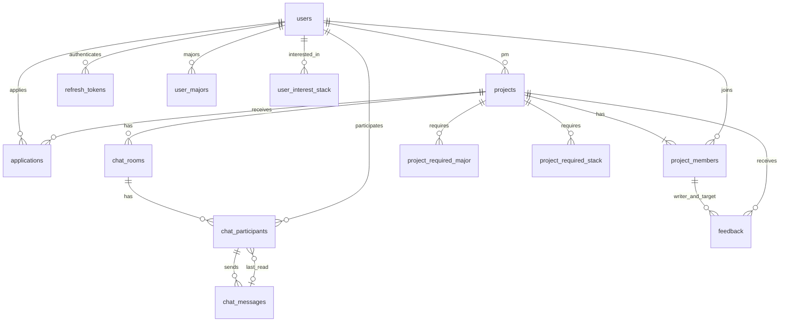

# F.A.T. Backend

프로젝트 모집·지원·팀 활동을 위한 Spring Boot / JPA / MySQL 백엔드다. 첨부된 노션 API 명세서의 요청·응답·에러 정의를 기준으로 GitHub 관련 기능 4개를 제외한 **30개 API**를 구현한다. 작업 기준 브랜치는 `dev`이며, 최초 데이터 모델은 `1-feat-login-signup@043c352`의 Entity와 주요 PK·컬럼을 유지해 확장했다.

## 실행 환경과 설정

JDK 17, 저장소의 Gradle Wrapper 9.5.1, MySQL 8.4가 필요하다. MySQL 통합 테스트에는 Docker가 필요하다.

```bash
cp .env.example .env
# .env의 DB 비밀번호, 두 개의 독립적인 서버 비밀키, SMTP 설정을 채운다.
# .env는 셸에서 읽을 수 있는 KEY=value 형식으로 작성하고 필요한 값은 따옴표로 감싼다.
set -a
. ./.env
set +a
docker compose up -d --wait
bash gradlew bootRun
```

Compose는 `127.0.0.1:3307`의 개발 전용 `fat_dev` DB와 `fat_mysql_dev` 볼륨을 사용한다. 기존 MySQL을 쓴다면 Compose 대신 개발 전용 DB의 연결 환경변수를 설정한다. DB·볼륨 초기화는 필요하지 않다. 기존 볼륨의 비밀번호는 환경변수만 바꿔도 변경되지 않으므로 MySQL의 계정 변경 절차를 사용한다.

| 환경변수 | 용도 |
| --- | --- |
| `DB_URL`, `DB_USERNAME`, `DB_PASSWORD` | 애플리케이션의 MySQL 연결. 실제 비밀번호를 Git에 저장하지 않는다 |
| `MYSQL_ROOT_PASSWORD` | 로컬 Compose DB 초기 계정용. 애플리케이션 계정과 구분한다 |
| `SPRING_PROFILES_ACTIVE` | 개발에서는 `dev`. 기본/prod는 자동 Flyway 실행을 끈다 |
| `JWT_SECRET` | HS256 JWT 서명키. UTF-8 기준 32바이트 이상, 기본값 없음 |
| `EMAIL_CODE_SECRET` | 6자리 인증 코드 HMAC 키. UTF-8 기준 32바이트 이상, JWT 키와 별도 관리 |
| `SMTP_HOST`, `SMTP_PORT`, `SMTP_USERNAME`, `SMTP_PASSWORD`, `SMTP_FROM` | 실제 인증 메일 전송 설정. 포트 기본값 587 |
| `SMTP_AUTH`, `SMTP_STARTTLS` | 기본값 모두 `true`. STARTTLS는 기본적으로 필수 |
| `AUTH_SECURE_COOKIE` | 기본값 `true`. 로컬 HTTP 개발에서만 `false`로 설정 |
| `AVATAR_STORAGE_PATH` | 아바타 저장 디렉터리. 기본값 `/workspace/shared/fat-avatars` |

키·비밀번호·실제 `.env`, DB 파일·백업 및 업로드 파일은 Git에 넣지 않는다. 테스트 키는 테스트 전용 리소스에만 있으며 배포 JAR에 포함하지 않는다. SMTP 설정이 없거나 전송이 실패하면 인증 코드를 성공한 것처럼 반환하지 않고 `MAIL_DELIVERY_FAILED`를 반환한다. 외부 SMTP 서버의 실제 전달 여부는 배포 환경의 설정으로 별도 검증해야 한다.

클라우드 작업은 이미 격리되어 있으므로 기존 `/workspace/F-A-T-backend` 체크아웃을 사용한다. 별도 Git worktree는 필요하지 않다.

## 공통 요청·응답과 인증

인증 API를 제외한 API는 `Authorization: Bearer {accessToken}`이 필요하다. 성공 응답은 `{"success":true,"data":...}`, 오류 응답은 `{"success":false,"error":{"code":"...","message":"..."}}`다. `204 No Content`는 본문이 없다. SQL·스택 트레이스·내부 예외 메시지는 클라이언트에 반환하지 않는다.

`CustomUserDetails`, JWT 필터·서명·인증 오류 응답은 `global/security`에 둔다. Controller는 요청 바인딩·응답 생성만 맡고 로그인·검증·갱신 등 업무 처리는 `AuthService`가 담당한다. Service는 `ApiException(ErrorCode)`를 사용하며 `GlobalExceptionHandler`가 명세의 상태 코드와 메시지로 변환한다. 필터 단계의 인증/권한 오류도 같은 오류 형식을 사용한다.

신규 가입 흐름은 이메일 코드 발송 → 검증 → 일회성 가입 토큰으로 회원가입 → 로그인이다. 학교 이메일은 `@dsm.hs.kr`로 제한한다. 인증 코드는 5분, 재발송 간격은 60초, 실패 시도는 5회로 제한한다. 인증 코드는 서버에서 생성하고 HMAC으로 저장하며 응답·로그에 원문을 노출하지 않는다. 가입 토큰은 10분 동안 유효하고 이메일에 연결되며 한 번만 사용할 수 있다. 비밀번호는 BCrypt로 저장한다.

로그인 시 유효기간 3600초인 JWT와 14일 refresh 세션을 발급한다. refresh 토큰 원문 대신 digest만 DB에 저장한다. 쿠키는 `HttpOnly`, `Secure`(기본값), `SameSite=Strict`, `Path=/auth`다. 갱신 요청은 refresh 쿠키로 새 JWT와 회전된 쿠키를 받고 이전 refresh 토큰은 사용할 수 없다. 로그아웃은 현재 세션을 폐기하고 쿠키를 지우며 해당 세션의 JWT도 이후 요청에서 거절한다. 운영에서는 HTTPS를 사용하고 브라우저의 쿠키·CORS 조건에 맞게 프런트엔드와 API를 배치한다. CORS 허용 출처의 기본값은 `http://localhost:3000`이며 `app.cors.origins`로 설정한다.

기존 계정의 이메일 소유권은 마이그레이션만으로 확인할 수 없으므로 `emailVerified=false`를 유지한다. 기존 사용자는 `/auth/email/send`에 `purpose:"VERIFY_ACCOUNT"`, 자신의 이메일과 현재 비밀번호를 보내고 받은 코드를 `/auth/email/verify`로 검증한다. 이 확장 흐름은 `{"verified":true}`를 반환하고 기존 계정을 인증 완료로 바꾸며 가입 토큰을 새로 발급하지 않는다. 검증 전 로그인은 `EMAIL_NOT_VERIFIED`로 거절된다. 기존 비밀번호 해시는 변경하지 않는다.

## API 목록

명세의 기본 경로를 아래에 기재했다. 일부 프로젝트·지원 경로의 `/api/v1` 별칭은 명세 예시와의 호환을 위한 것이며, 아래 경로를 공통 기준으로 사용한다. 예전 세션 인증 경로(`/signup`, `/login`, `/mypage`, `/projects/{id}/status`) 대신 새 계약을 사용한다.

| # | Method | 경로 | 기능 |
| --- | --- | --- | --- |
| 1 | POST | `/auth/email/send` | 인증코드 발송·재전송 제한 |
| 2 | POST | `/auth/email/verify` | 코드 검증·일회성 가입 토큰 |
| 3 | POST | `/auth/signup` | 이메일 인증 후 회원가입 |
| 4 | POST | `/auth/login` | JWT·refresh 쿠키 발급 |
| 5 | POST | `/auth/refresh` | JWT 갱신·refresh 토큰 회전 |
| 6 | POST | `/auth/logout` | 세션 폐기·쿠키 삭제, 204 |
| 7 | GET | `/users/me` | 내 프로필·프로젝트/평가 통계 |
| 8 | PATCH | `/users/me` | 닉네임·소개·성별·전공·스택 수정 |
| 9 | POST | `/users/me/avatar` | multipart 이미지 업로드 |
| 10 | GET | `/users/{userId}` | 이메일·학번·본명을 제외한 공개 프로필 |
| 11 | GET | `/users/me/projects` | 참여 프로젝트 이력·단계 필터·페이지 |
| 12 | GET | `/projects` | 검색어·전공·스택·모집 상태 필터·페이지 |
| 13 | GET | `/projects/recommended` | 사용자 전공·스택 기반 추천 |
| 14 | GET | `/projects/{projectId}` | 프로젝트 상세·팀원·지원 가능 여부 |
| 15 | POST | `/projects` | 프로젝트·PM 팀원·팀 채팅 참여 등록 |
| 16 | PATCH | `/projects/{projectId}` | PM의 프로젝트 내용·모집 조건 수정 |
| 17 | PATCH | `/projects/{projectId}/stage` | PM의 진행 단계 변경 |
| 18 | GET | `/projects/{projectId}/members` | 팀원 카드·PM/MEMBER 역할 |
| 19 | POST | `/projects/{projectId}/applications` | 포지션·사유를 담은 지원 |
| 20 | GET | `/projects/{projectId}/applications` | PM 지원자 목록·상태 필터·페이지 |
| 21 | GET | `/users/me/applications` | 본인 지원 내역·페이지 |
| 22 | PATCH | `/applications/{applicationId}` | PM 승인·거절, 수락 시 팀원/팀방 등록 |
| 23 | DELETE | `/applications/{applicationId}` | 본인의 대기 중 지원 취소, 204 |
| 24 | GET | `/chat-rooms` | 내 방·최근 메시지·읽지 않은 수 |
| 25 | POST | `/chat-rooms/direct` | PM 커피챗 생성 또는 기존 방 재사용 |
| 26 | GET | `/chat-rooms/{roomId}/messages` | 커서 기반 이전 메시지·읽음 처리 |
| 27 | POST | `/chat-rooms/{roomId}/messages` | 텍스트 전송·clientMessageId 중복 방지 |
| 28 | POST | `/projects/{projectId}/feedback` | 완료 프로젝트 PM의 팀원 평가 |
| 29 | GET | `/users/me/feedback` | 받은 평가·평균 별점·페이지 |
| 30 | GET | `/projects/{projectId}/feedback-status` | PM의 평가 완료/미완료 팀원 상태 |

프로젝트 검색의 쿼리 이름은 `query`, `major`, `techStack`, `recruitmentStatus`, `page`, `size`다. 모집 상태는 `OPEN`/`CLOSED`이며 PM 포함 정원, 마감일, 완료 여부를 반영한다. 추천은 모집 중이며 내가 팀원이 아닌 프로젝트를 전공 일치(2점)·스택 일치(1점)로 정렬하는 `RULE_BASED` 방식이다. 외부 AI 서비스는 호출하지 않는다.

진행 단계는 `IDEA → IN_PROGRESS → COMPLETED` 순서로만 변경한다. 정원은 PM을 포함한 1~12명이다. 프로젝트 행 잠금과 트랜잭션으로 동시 지원 수락의 정원·중복 문제를 막는다. 이미 결정한 지원은 다시 결정할 수 없다. 지원 취소는 행 삭제 대신 `CANCELLED` 이력으로 남기며, 현재 동일 프로젝트 재지원은 허용하지 않는다. 팀원 탈퇴·PM 교체·수락 취소는 포함하지 않는다.

채팅은 프로젝트 팀방 `TEAM`과 PM/요청자 1:1 방 `DIRECT`로 구분한다. 참여자만 내역 조회·전송이 가능하며, 커서는 `message_{id}` 형식의 `before`와 `size`로 사용한다. 읽음 위치는 같은 방의 메시지에 대해서만 전진한다. 메시지 `clientMessageId`가 같은 재전송은 409 `DUPLICATE_MESSAGE`다. 피드백은 완료 프로젝트 PM만 본인을 제외한 팀원에게 작성할 수 있고, 배치 전체를 검증한 뒤 저장해 중간 일부만 저장되지 않게 한다.

프로필 사진은 PNG/JPEG의 MIME과 실제 이미지 내용을 검사하고 5MiB·2천만 픽셀로 제한한다. 최대 변 1024로 줄여 새 UUID 파일명의 PNG로 재인코딩한다. 원래 파일명·메타데이터를 저장하지 않는다. 반환된 `/avatars/{uuid}.png`는 공개 프로필 이미지로 읽을 수 있고 `nosniff` 헤더를 보낸다. 파일은 DB가 아닌 `AVATAR_STORAGE_PATH`에 저장하므로 운영에서 영속 볼륨·백업이 필요하다. 가입 요청의 `avatarFileId`는 현재 `null`이어야 하며 가입·로그인 후 인증된 업로드 API를 사용한다.

## 데이터 모델과 변경 이유



기존의 `user`, `project`, `project_application`, `chat_room`, `chat_message`를 복수형 테이블로 옮기면서 PK·본문·비밀번호 해시·지원 상태를 보존했다. 수락된 지원서로만 팀원을 추정하던 구조를 `project_members`로 분리해 PM도 포함하고, `chat_participants`로 메시지 발신 자격과 읽음 위치를 표현한다. PM 역할은 `projects.pm_id`를 기준으로 도출해 별도 역할 컬럼의 불일치를 피한다.

| 테이블 | 핵심 키·제약 |
| --- | --- |
| `users` | `user_id` PK, 이메일 UNIQUE·필수, 신규 닉네임 UNIQUE(레거시 NULL 허용), 인증 여부 NOT NULL. 기존 표시 이름·학번·단일 전공 필드 보존 |
| `projects` | `project_id` PK, `pm_id` FK·필수, 제목·소개·마감·단계·정원·조회수 필수, 정원 양수·조회수 음수 금지 |
| `applications` | `application_id` PK, 프로젝트·신청자 FK·필수, UNIQUE(project,applicant). 상태 필수, 기존 포지션/사유의 NULL은 보존 |
| `project_members` | `project_member_id` PK, 프로젝트·사용자 FK·필수, UNIQUE(project,user) |
| `chat_rooms` | `chat_room_id` PK, 프로젝트 FK·필수. 생성 컬럼 UNIQUE로 프로젝트별 TEAM 1개, UNIQUE(project,requester)로 DIRECT 요청자별 1개 |
| `chat_participants` | `chat_participant_id` PK, 방·사용자 FK·필수, UNIQUE(room,user), 읽음 메시지는 동일 방의 메시지로 복합 FK |
| `chat_messages` | `chat_message_id` PK, 방·발신자·내용·시각 필수, (room,sender) → 참여자 복합 FK. UNIQUE(room,sender,client_message_id), 레거시 client ID는 NULL 허용 |
| `feedback` | `feedback_id` PK, 프로젝트·작성자·대상 FK 및 팀원 복합 FK, UNIQUE(project,writer,target), 평점 1~5·자기평가 금지 |
| 전공·스택 컬렉션 | `user_majors`, `user_interest_stack`, `project_required_major`, `project_required_stack`: 소유자 FK와 값의 복합 PK, 모두 NOT NULL |
| `email_verifications` | PK, 코드 HMAC·이메일·만료·시도 수·purpose 필수, 시도 0~5, 가입 토큰 digest UNIQUE. 가입 전 이메일도 다뤄 users FK 없음 |
| `email_delivery_limits` | 이메일 PK, 최근 발송시각 필수. 잠금으로 동시 재전송 제한 |
| `refresh_tokens` | PK, 사용자 FK·필수, 토큰 digest UNIQUE·필수, 생성/만료 필수, 폐기시각 nullable |

기존 `inquiry`와 `inquiry_messages`, 제외된 GitHub 연동의 `users.github_username` 값은 보존한다. 원래 미완성이었던 InquiryMessage 매핑은 복구했으며, 새 커피챗은 chat 모델을 사용한다. FK는 삭제 전파를 사용하지 않아 사용자·프로젝트를 삭제할 때 과거 메시지·평가가 자동 소실되지 않는다. FK만으로 모든 서비스 권한·단계 전이를 보장하는 것은 아니다.

## Flyway와 기존 데이터 보존

`dev` 프로필에서 Flyway를 실행하며 Hibernate는 `validate`만 수행한다. 기본/prod는 자동 Flyway 실행을 끈다. `clean-disabled=true`, `baseline-on-migrate=false`를 유지한다. 운영 적용은 별도 승인된 배포 절차로만 수행한다.

| 버전 | 내용 |
| --- | --- |
| V1 | **빈 DB용** 레거시 참조 스키마 |
| V2 | 기존 데이터 사전검사, 테이블 rename, PK 보존, PM/ACCEPTED 지원자의 팀원·팀방 참여 백필, FK/UNIQUE/CHECK |
| V3 | 인증 상태 모델, 아바타·지원 포지션·모집 여부, TEAM/DIRECT·읽음 위치. 원래 알 수 없는 값은 NULL 유지 |
| V4 | 닉네임·본명·문자열 학번·다중 전공·인증 여부. 기존 이름/학번/전공을 보존하고 인증은 임의 완료하지 않음 |
| V5 | 프로젝트/지원/평가 시각, 메시지 클라이언트 ID, 인증 목적·메일 재전송 제한. 과거 시각은 알 수 없어 백필 시각이며 원래 생성시각이라고 간주하지 않음 |

자동 DB 삭제·초기화·중복 제거·`FOREIGN_KEY_CHECKS=0`을 사용하지 않는다. V2는 중복 지원/평가, 자기평가·잘못된 평점, NULL/중복 컬렉션, 잘못된 정원·조회수, 팀원이 아닌 과거 발신자/평가 참여자가 있으면 rename 전에 중단한다. 문제 기록을 삭제하거나 자동으로 팀원 자격을 부여하지 않는다. 초기 unread에는 과거 읽음 여부를 알 수 없는 보존 메시지가 포함될 수 있다.

기존 DB 적용 시 다음 순서를 따른다.

1. 운영은 별도 승인과 정비 시간을 확보하고 쓰기를 중단한다. 백업을 만들고 실제 복원이 가능한지 검증한다.
2. 원본 대신 격리한 복제 DB에서 `SHOW CREATE TABLE`, 행 수·PK·인덱스·collation·고아 FK·사전검사 조건을 확인한다. V1과 다른 실DB 스키마는 별도의 보완 검토가 필요하다.
3. **Flyway 이력이 없고 정확히 V1 구조인 기존 DB만** 명시적으로 version 1 baseline한다. 이미 버전 관리 중인 DB에는 다시 baseline하지 않는다.

   ```bash
   FLYWAY_URL="$DB_URL" FLYWAY_USER="$DB_USERNAME" FLYWAY_PASSWORD="$DB_PASSWORD" \
     flyway -baselineVersion=1 baseline
   ```

4. 복제 DB에서 V2~V5를 적용해 schema validate와 기능 검증을 수행하고, 전후 행 수·PK·본문·상태·관계를 대조한다. 운영에는 검토한 동일 SQL을 승인된 배포 작업으로 적용한다.
5. MySQL DDL은 여러 문장을 원자적으로 rollback하지 못한다. 권한·디스크·구조 차이로 중간 실패하면 일부 변경이 남는다. 무조건 재실행하거나 `repair`로 오류를 숨기지 말고 백업 복원 또는 실제 상태를 확인한 승인된 forward-fix를 사용한다.

기존 Git 이력에 포함됐던 DB 비밀번호가 실제 자격증명이었다면 소유자가 폐기·교체해야 한다. 이력을 강제 재작성하지 않는다. 저장된 설정·코드만으로 운영 적용이 승인된 것은 아니다.

## 테스트

```bash
bash gradlew test bootJar
```

테스트는 Testcontainers의 독립 MySQL을 사용하며 운영/개발 `DB_URL`에 연결하지 않는다. 마이그레이션 테스트는 각 테스트마다 별도 스키마를 만들고 기존 DB를 초기화하지 않는다. 서비스·Repository 테스트와 실제 HTTP 흐름에서 이메일 인증·JWT/쿠키 회전·권한·프로필·검색·지원·채팅·평가 및 오류 응답을 검증한다. 이미지 테스트는 형식 위장·크기·픽셀 제한·경로 순회를 확인한다. 인증 HTTP 테스트의 메일은 테스트용 수신기가 캡처하므로 외부 SMTP로 실제 메일을 보내는 검증과 구분한다. Docker 부재로 skip되거나 0개 실행된 결과를 통과로 간주하지 않는다.

현재 변경의 로컬 검증: `test bootJar` 성공, 테스트 67개·실패/오류/스킵 0. 원격 CI와 외부 SMTP 실전송 결과는 이 로컬 검증과 별개다.
